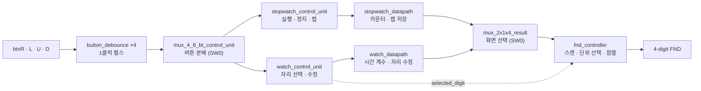

# Watch · Stopwatch 통합 설계

Basys 3 FPGA에서 동작하는 **24시간 디지털 시계(Watch)** 와 **랩타임 스톱워치(Stopwatch)** 를 Verilog로 설계한 KDT 미니 프로젝트입니다.
두 기능은 서로 독립적으로 동시에 카운트하며, 스위치로 4자리 7-세그먼트(FND)에 표시할 화면과 시간 단위를 선택합니다.

- **보드**: Basys 3 (AMD Xilinx Artix-7), 100 MHz
- **언어 · 툴**: Verilog HDL, Vivado
- **팀원**: 박재균 · 조수영

<br>

## 📌 주요 기능

| 구분 | 기능 |
|---|---|
| **Watch** | 24시간 시계 (리셋 시 12:00부터 시작), 자리별 시간 수정, 수정 중인 자리 2 Hz 점멸 |
| **Stopwatch** | 실행 · 정지, 초기화, 업/다운 카운트 전환, **랩타임 저장** (랩 표시 중에도 내부 카운트 유지) |
| **공통 표시** | `sec.msec` / `hour.min` 표시 단위 선택, 1초 주기 가운데 점 점멸 |

- **독립 카운팅**: 시계와 스톱워치 데이터패스가 분리되어 있어, 화면을 전환해도 양쪽 모두 백그라운드에서 계속 카운트합니다.
- **범용 카운터 재사용**: `TIMES` 파라미터 하나로 msec(100) · sec(60) · min(60) · hour(24) 카운터를 같은 모듈로 구성했습니다.

<br>

## 🎮 조작 방법

### 스위치

| 스위치 | 0 | 1 |
|---|---|---|
| **SW0** (`sw_show_mode`) | 시계 화면 | 스톱워치 화면 |
| **SW1** (`sw_display_mode`) | `sec . msec` | `hour . min` |
| **SW2** (`sw_time_edit`) | 일반 | 시계 시간 수정 |

### 버튼

| 버튼 | 시계 (SW2 = 1, 수정 중) | 스톱워치 (SW0 = 1) |
|---|---|---|
| **btnR** | 오른쪽 자리로 이동 | 시작 / 정지 |
| **btnL** | 왼쪽 자리로 이동 | 초기화 (정지 상태에서) |
| **btnU** | 선택한 자리 +1 | 업 / 다운 카운트 전환 (정지 상태에서) |
| **btnD** | 선택한 자리 −1 | 랩타임 저장 (실행 중) |
| **btnC** (`rst`) | 전체 초기화 | 전체 초기화 |

> 버튼 입력은 SW0에 따라 시계 쪽 또는 스톱워치 쪽 제어 유닛으로만 전달됩니다.

<br>

## 🧩 전체 구조



두 데이터패스는 서로 연결 없이 독립적으로 동작하고, 결과 MUX가 표시할 시간만 선택합니다.

<br>

## 📂 프로젝트 구조

```
.
├── source_code/
│   ├── watch_stopwatch.v   # Top: watch_stopwatch_top, 결과 MUX, 버튼 분배기
│   ├── button_debounce.v   # 버튼 디바운스 + 상승 에지 검출
│   ├── control_unit.v      # stopwatch_control_unit, watch_control_unit
│   ├── stopwatch.v         # stopwatch_datapath (tick_gen, tick_counter, 랩 레지스터)
│   ├── watch.v             # watch_datapath (tick_counter_watch: 자리별 수정 지원)
│   └── fnd_controller.v    # FND 스캔 · BCD 변환 · 수정 자리 점멸
├── tb_code/
│   ├── tb_btn_debounce.v              # 디바운스 단위 검증
│   ├── tb_stopwatch_control_unit.v    # 스톱워치 CU 상태 전이 · 우선순위
│   ├── tb_watch_control_unit.v        # 시계 CU 자리 순환 · 우선순위
│   ├── tb_watch_Basic_Functions.v     # 통합: 기본 기능
│   ├── tb_watch_datapath.v            # 통합: 시간 수정 · 자리올림 · 경계값
│   └── tb_watch_stopwatch_full_sin_0.v# 통합: 스톱워치 실행 · 모드 전환 · 경계값
├── constrain/
│   └── Basys-3-Master.xdc             # Basys 3 핀 제약
├── stopwatch_24watch.pptx             # 발표 자료
├── 조수영_박재균_watch_stopwatch.pdf    # 발표 자료 PDF
└── README.md
```

<br>

## 🔍 모듈 설명

### `button_debounce`
100 MHz 클럭을 1 MHz 샘플 펄스로 나눠 버튼을 8비트 시프트 레지스터에 샘플링하고, **8회 연속 HIGH**일 때만 눌린 것으로 판단합니다. 이후 상승 에지를 검출해 **1클럭 폭 펄스**를 출력합니다.

### `stopwatch_control_unit` — 스톱워치 FSM

| 상태 | 출력 | 전이 |
|---|---|---|
| `STOP` | 카운트 정지 | R → `RUN`, L → `CLEAR`, U → `MODE` |
| `RUN` | `run_stop = 1` | R → `STOP`, D → `LAPTIME` (현재 시간 저장) |
| `CLEAR` | `clear = 1` | 다음 클럭 `STOP` |
| `MODE` | 업/다운 방향 토글 | 다음 클럭 `STOP` |
| `LAPTIME` | `run_stop = 1`, 랩 값 표시 | R → `STOP`, D → 저장값 갱신 |

- 초기화 · 방향 전환은 **정지 상태에서만** 동작합니다.
- 동시 입력 시 R(실행/정지)이 우선합니다.

### `watch_control_unit` — 시계 수정 FSM
SW2 = 1이면 수정 모드로 들어가 `S1 → S10 → S100 → S1000` 4개 자리 중 하나를 선택합니다. btnL / btnR로 자리를 순환하고(동시 입력 시 R 우선), btnU / btnD는 데이터패스의 `up` / `down`으로 전달됩니다. SW2 = 0이면 즉시 일반 상태로 돌아갑니다.

### `stopwatch_datapath`
`tick_gen_100hz`(10 ms 틱) → msec(100) → sec(60) → min(60) → hour(24) `tick_counter` 4개를 직렬로 연결했습니다. `mode`에 따라 업/다운 카운트하며, `stopwatch_laptime` 레지스터에 랩 시점 값을 저장하고 `mux_2x1x4_lapstop`이 실시간 값과 랩 값 중 표시할 값을 고릅니다.

### `watch_datapath` — `tick_counter_watch`
`TIMES` 하나로 각 단위의 최댓값과 자리별 한계를 자동 계산해, 범위가 다른 단위를 **같은 모듈 × 4 인스턴스**로 처리합니다.

| 단위 | TIMES | max | 10의 자리 최대 | 1의 자리 최대 |
|---|---|---|---|---|
| msec | 100 | 99 | 9 | 9 |
| sec | 60 | 59 | 5 | 9 |
| min | 60 | 59 | 5 | 9 |
| hour | 24 | 23 | 2 | 3 |

수정 시 **선택한 자리만** 바뀌고 다른 자리로 올림/내림이 생기지 않도록, 1의 자리와 10의 자리를 분리해 계산합니다.
- 10의 자리가 최대(예: hour 2x)면 1의 자리는 `0 ~ 3`, 아니면 `0 ~ 9`
- 1의 자리가 한계보다 크면(예: hour x9) 10의 자리는 `0 ~ 1`로 제한 → 29시 같은 값이 나오지 않음

### `fnd_controller`
- 100 MHz → **2 kHz** 분주 클럭으로 `counter_8`이 8개 슬롯을 순환하며 4자리를 스캔 (잔상 효과)
- `digit_splitter`로 각 단위를 1의 자리 / 10의 자리로 분리, SW1로 `sec.msec` 또는 `hour.min` 선택
- 가운데 점은 `msec < 50`일 때 켜져 1초 주기로 깜빡임
- 시계 수정 중에는 `selected_digit` 자리를 **2 Hz로 점멸**
- `fnd_com`, `fnd_font` 모두 Active-Low

<br>

## 🧪 시뮬레이션

### 단위 검증

| 대상 | 시나리오 | 확인 결과 |
|---|---|---|
| 버튼 디바운스 · 분배 | HIGH 유지 시 1 MHz 샘플 8회 관찰, SW0 전환 후 재입력 | 8번째 샘플에서 1클럭 펄스, 선택된 CU 쪽만 입력 추종 |
| Watch CU | SW2 = 1에서 L / R 반복, U / D 입력 | 자리 `00 → 01 → 10 → 11 → 00` 순환, up / down 전달 |
| Stopwatch CU | 랩 표시 중 L / U / D, 이후 R | L / U 무시, D는 `lap_cap` 펄스, R 이후 `STOP` |

### 통합 검증

| ID | 시나리오 | 확인 결과 |
|---|---|---|
| S1 | 정지 → 방향 전환 → 실행 | 전환 전과 반대 방향으로 카운트 시작 |
| S2 | 실행 중 랩 저장 | 내부 카운트는 계속, FND는 저장 시점 값 유지 |
| S3 | 시계 시간 수정 · 커서 점멸 | 수정 중 카운트 정지, 자리 이동 · 증감 · 경계(00 → 09, 09 → 19) 정상, 해제 후 수정된 값부터 카운트 |
| S4 | 시계 · 스톱워치 동시 카운트 | 화면 전환과 무관하게 양쪽 모두 백그라운드 카운트 |
| S5 | 경계값 `23:59:59.99` | 다음 틱에 `00:00:00.00`으로 정상 롤오버 |

### 실행 방법 (Vivado)
1. `source_code/` 의 `.v` 파일을 **Design Sources**로 추가 (Top: `watch_stopwatch_top`)
2. `tb_code/` 의 테스트벤치 중 하나를 **Simulation Sources**로 추가하고 Top으로 지정
3. **Run Behavioral Simulation** 실행 후 파형 확인

<br>

## 🔌 보드 실행

`constrain/Basys-3-Master.xdc` 핀 매핑

| 포트 | 핀 | Basys 3 |
|---|---|---|
| `clk` | W5 | 100 MHz 클럭 |
| `rst` | U18 | btnC |
| `btnU` / `btnL` / `btnR` / `btnD` | T18 / W19 / T17 / U17 | 상 / 좌 / 우 / 하 버튼 |
| `sw_show_mode` / `sw_display_mode` / `sw_time_edit` | V17 / V16 / W16 | SW0 / SW1 / SW2 |
| `fnd_font[7:0]` | W7, W6, U8, V8, U5, V5, U7, V7 | 세그먼트 a ~ g, dp |
| `fnd_com[3:0]` | U2, U4, V4, W4 | 자리 선택 AN0 ~ AN3 |

1. XDC 파일을 **Constraints**로 추가
2. Synthesis → Implementation → Generate Bitstream
3. Hardware Manager로 보드에 다운로드

<br>

## 🛠 트러블슈팅

**현상**: 시간 수정 중 1의 자리에 +1을 하면 `09 → 10`처럼 10의 자리까지 바뀜
**원인**: 카운터 값 전체에 ±1 / ±10을 더해서 자리 올림 · 내림이 발생
**해결**: 현재 값을 1의 자리 / 10의 자리로 나눠 **선택한 자리만** 증감하고 다시 합치도록 변경 (`09 → 00`)

<br>

## 💡 결론 및 고찰

**구현 성과**
- `tick_counter`를 파라미터화해 시계 · 스톱워치에서 재사용 → 코드량 감소, 가독성 향상
- 시계와 스톱워치가 서로 영향 없이 독립적으로 카운트
- 랩타임, 자리별 시간 수정, 수정 커서 점멸 등 부가 기능 구현

**배운 점**
- 기능 흐름을 먼저 정리하고, 상태 판단(CU)과 데이터 연산(Datapath)을 서로 다른 모듈로 분리
- 각자 설계한 모듈을 통합할 때는 신호 의미 · 상태 조건 · 우선순위를 미리 합의하고 문서화해야 함
- 정상 동작뿐 아니라 경계값 등 다양한 시나리오로 검증 범위를 넓혀야 함

**한계 및 개선 방향**

| 한계 | 개선 방향 |
|---|---|
| 현재 업/다운 방향을 확인할 수 없음 | 방향 상태를 LED로 표시 |
| 랩타임 표시와 정지 상태가 구별되지 않음 | 랩타임 표시 중 FND 점멸 |
| 기능 다양성 부족 | 타이머 기능 추가 |

<br>

## 👥 Team
- **박재균**
- **조수영** ([@ccocco33](https://github.com/ccocco33))